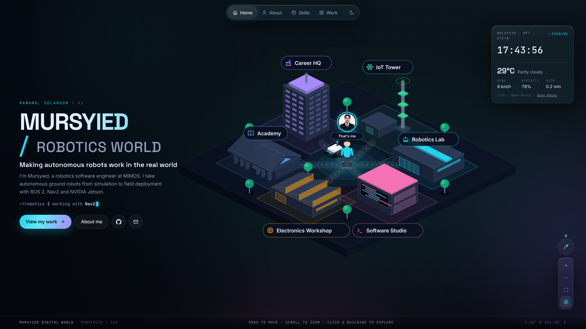

# Mursyied · Portfolio

My personal portfolio as a robotics software engineer working on autonomous ground robots with ROS 2. A futuristic glass design with Home, About and Work pages, a page per project, smooth page transitions, a live Kuala Lumpur clock, and dark and light modes.

**Live:** https://mursyied-portfolio.vercel.app



Built with [Astro](https://astro.build) as a static site: no framework on the page, about 4 KB of JavaScript for the animations, hosted free on GitHub Pages.

## Run it locally

Needs Node.js 20 or later.

```bash
git clone https://github.com/MuhamadMursyied/Mursyied-Portfolio.git
cd Mursyied-Portfolio
npm install
npm run dev        # http://localhost:4321/Mursyied-Portfolio
```

`npm run build` type-checks everything and builds the site into `dist/`. GitHub runs the same command on every push.

## Where to edit things

| What | File |
| --- | --- |
| Name, headline, intro, experience, studies, certifications, skills, roadmap | `src/data/profile.ts` |
| Projects (one Markdown file each) | `src/content/projects/*.md` |
| Images | `public/images/` |
| Colours and the glass look | `src/styles/global.css` (variables at the top) |
| Animations and interactions | `src/scripts/ui.ts` |
| Icons | `src/components/Icon.astro` (brand icons from simple-icons, outline icons from Tabler) |

### Add a project

Create `src/content/projects/my-project.md`:

```md
---
title: "UGV row following with Nav2"
date: "2026-11"            # "2026", "2026-11" or "2026-11-05" (optional)
org: "MIMOS Berhad"        # optional
summary: "One or two lines shown on the card."
tags: ["ROS 2", "Nav2"]
images:
  - "images/projects/my-project-1.jpg"   # put the files in public/images/projects
links:
  - label: "Video"
    url: "https://youtube.com/..."
featured: true             # optional: listed first
draft: true                # optional: hide it from the site
---

## Overview

What the problem was, what you did and how it turned out.
```

Robotics projects currently use generated title cards as covers. Replace them with real photos or RViz/Gazebo screenshots (16:9) when you can.

CV Builder and Kedai POS are kept as drafts (`draft: true`) and are not published; their screenshots are in `drafts/images/`.

## Deploying

`.github/workflows/deploy.yml` builds and publishes the site to GitHub Pages on every push to `main`.

One-time setup: **Settings → Pages → Build and deployment → Source: GitHub Actions**.

It also deploys on [Vercel](https://vercel.com) with no settings: import the repo and keep the Astro preset. Vercel serves the site from the root, and `astro.config.mjs` detects the Vercel build (`VERCEL=1`) and drops the `/Mursyied-Portfolio` base path.

### Custom domain

1. Buy a domain (for example `mursyied.dev`) and add it under **Settings → Pages → Custom domain**, following GitHub's DNS instructions.
2. In `astro.config.mjs`, set `site` to `https://mursyied.dev` and `base` to `"/"` (or set the `SITE_URL` and `BASE_PATH` environment variables in the workflow).

## License

Code: MIT. Content, photos and project descriptions: © Muhamad Mursyied, all rights reserved.
